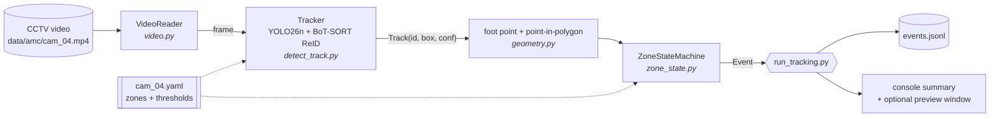
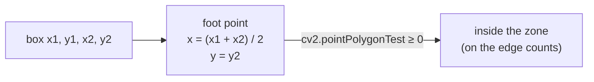
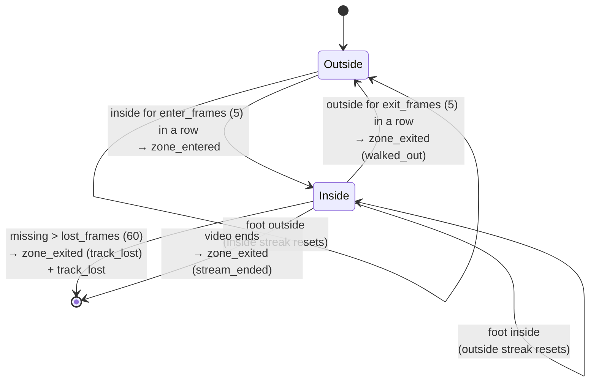

# warehouse-zone-counter

Counts people moving through zones on warehouse CCTV. Each person is tracked, their foot point is tested against one **red** and one **green** floor polygon per camera, and every entry and exit is written as an event with its dwell time.

- **Red zone** (`aisle_main`): every visit with entry, exit and dwell, plus repeat entries per track ID.
- **Green zone** (`walkway_front`): every visit with entry, exit and dwell. Traffic only, no per-person repeats.

> **Status: step 3 of week 1.** Config, tracking, the zone state machine and a preview runner work. The SQL event store, face blur, snapshots and dashboard are next. See the [roadmap](#roadmap).

## How it works



`zone_state.py` knows nothing about video, files or SQL. It takes a list of tracks and returns a list of events, so the whole counting logic is tested with plain Python lists.

### Why the foot point

A camera mounted high sees a person's waist drift over zones behind them. The feet are what touch the floor, so membership is tested at the **bottom-centre** of the box.



### Zone state machine

Each `(track, zone)` pair has its own state. A single frame on the wrong side of the line never flips it: the foot point must stay inside for `enter_frames` frames in a row to enter, and outside for `exit_frames` frames in a row to leave.



Timestamps are backdated so dwell is not padded by the confirmation delay: **entry time is the first frame of the inside streak**, and **exit time is the first frame of the outside streak**.

```mermaid
gantt
    title One visit on the frame timeline (enter_frames = exit_frames = 5)
    dateFormat X
    axisFormat %s
    section Foot point
    outside          :done, 0, 10
    inside           :active, 10, 40
    outside          :done, 40, 50
    section Confirmation
    5 inside frames, zone_entered emitted   :crit, 10, 15
    5 outside frames, zone_exited emitted   :crit, 40, 45
    section Recorded visit
    entered 10, exited 40, dwell 30 frames  :active, 10, 40
```



Because events are emitted when confirmed, the log is **not** always in time order (a `track_lost` exit is only known about 2 s later). Sort by `occurred_at` when you read time.

### Events

Every event has the same shape. `occurred_at` is video time (`recording_start + frame / fps`), never the wall clock, because the footage carries no timestamp.

```python
@dataclass(frozen=True)
class Event:
    event_id: str          # uuid4
    event_type: str
    occurred_at: str       # video time, ISO 8601 UTC
    camera_id: str
    track_id: int | None
    zone_id: str | None
    payload: dict
    schema_version: int = 1
```

| `event_type` | Written when | Payload |
| --- | --- | --- |
| `track_started` | the tracker gives a new ID | `box` |
| `zone_entered` | foot point inside for `enter_frames` in a row | `colour`, `foot_point`, `confirmed_at`, `visit_no` (red only) |
| `zone_exited` | outside for `exit_frames` in a row, track lost, or video ended | `colour`, `entered_at`, `dwell_s`, `reason`, `visit_no` (red only) |
| `track_lost` | ID missing for more than `lost_frames` | `last_seen`, `reason` |

Every payload also carries `frame`, the frame index the event refers to.

## Quick start

Needs Python 3.11+ and [uv](https://docs.astral.sh/uv/).

```bash
uv sync
uv run pytest
```

The video is not in the repo. Put it at `data/amc/cam_04.mp4` (`data/` is git-ignored). `yolo26n.pt` downloads on first run.

**1. Draw the zones** on a frame of the video. Click along the floor where feet stand, not the rack tops. Press `n` to finish each zone, `s` to save.

```bash
uv run python tools/draw_zones.py --config configs/zones/cam_04.yaml
```

**2. Preview tracking** with a local window showing zones, boxes, foot points and track IDs:

```bash
uv run python tools/run_tracking.py --config configs/zones/cam_04.yaml --max-frames 900 --show
```

**3. Run the full video** and keep the events:

```bash
uv run python tools/run_tracking.py --config configs/zones/cam_04.yaml --events-out outputs/cam_04_events.jsonl
```

## Configuration

One YAML file per camera, validated by Pydantic at startup. A bad config stops the program with a clear message. It never runs on defaults you did not write down.

| Key | `cam_04` | Meaning |
| --- | --- | --- |
| `recording_start` | `2026-01-01T08:00:00Z` | video time 0. Must have a timezone |
| `frame_size` | `[1920, 1080]` | written by `draw_zones.py`, checked against the video |
| `enter_frames` / `exit_frames` | `5` / `5` | frames in a row needed to enter or leave |
| `lost_frames` | `60` (~2 s) | a track missing longer than this is closed |
| `detector.imgsz` | `960` | 640 misses people far down the aisle |
| `detector.conf` | `0.3` | detection confidence threshold |

The config is rejected if it has unknown keys, a polygon under 3 points or with no area, points outside `frame_size`, anything other than exactly one red and one green zone, or a green zone with `track_repeats` or `snapshot_on_enter`.

Tracker changes from the Ultralytics `botsort.yaml` defaults, in `configs/trackers/botsort_reid.yaml`:

| Setting | Default | Here | Why |
| --- | --- | --- | --- |
| `track_buffer` | 30 | 60 | keep an ID through ~2 s behind a rack |
| `gmc_method` | `sparseOptFlow` | `none` | the camera never moves, so save the CPU |
| `with_reid` | `False` | `True` | appearance helps keep an ID through short occlusions |

## First measured run

`cam_04`, first 900 frames (30 s), PyTorch on CPU, `imgsz` 960. **CPU: Intel Core i5-11400H @ 2.70 GHz.**

| | |
| --- | --- |
| Throughput | 11.3 FPS (includes model warm-up) |
| Red (`aisle_main`) entries | 3, dwell 3.6 s / 10.4 s / 13.3 s |
| Green (`walkway_front`) visits | 3, dwell 3.3 s / 3.9 s / 0.3 s |
| Track IDs with 2+ red entries | none |

These are raw system counts, not yet checked against hand labels. The 0.3 s green visit looks like a detection flicker and is a candidate for tuning.

## Project layout

```text
configs/
  trackers/botsort_reid.yaml   tracker settings
  zones/cam_04.yaml            camera, thresholds, zone polygons
src/wzc/
  config.py                    Pydantic models for the YAML
  video.py                     frame reader
  detect_track.py              YOLO26n + BoT-SORT wrapper
  geometry.py                  foot point, point-in-polygon (pure)
  zone_state.py                enter/exit state machine (pure)
  events.py                    event dataclass and video clock
tools/
  draw_zones.py                click tool for polygons
  run_tracking.py              preview runner
tests/                         config, geometry, zone state, imports
CODE_GUIDELINES.md             rules and contracts for the week 1 build
```

## Roadmap

```mermaid
flowchart LR
    subgraph done["Done"]
        A1[YAML config + validation]
        A2[YOLO26n + BoT-SORT ReID]
        A3[zone state machine + events]
        A4[draw_zones + run_tracking]
    end
    subgraph next["Next"]
        B1[append-only SQLite event store]
        B2[projector + replay]
        B3[face blur + red-entry snapshots]
        B4[FastAPI + live dashboard]
    end
    subgraph later["Then"]
        C1[hand labels + score.py]
        C2[ONNX / OpenVINO FPS]
        C3[Docker Compose + CI]
    end
    done --> next --> later
```



## Privacy

- **No identity.** Track IDs are anonymous integers. ReID appearance features stay inside the tracker's memory and are never written to disk.
- **No images leave the process yet.** Events and the JSONL file hold coordinates and times only. The `--show` and `draw_zones.py` windows are on-screen only and are **not blurred**, so do not screen-record them.
- **Face blur comes before any frame is saved or streamed.** It arrives with `privacy.py` together with snapshots and the dashboard, and there will be no flag to turn it off.
- Video and model weights are never committed.
